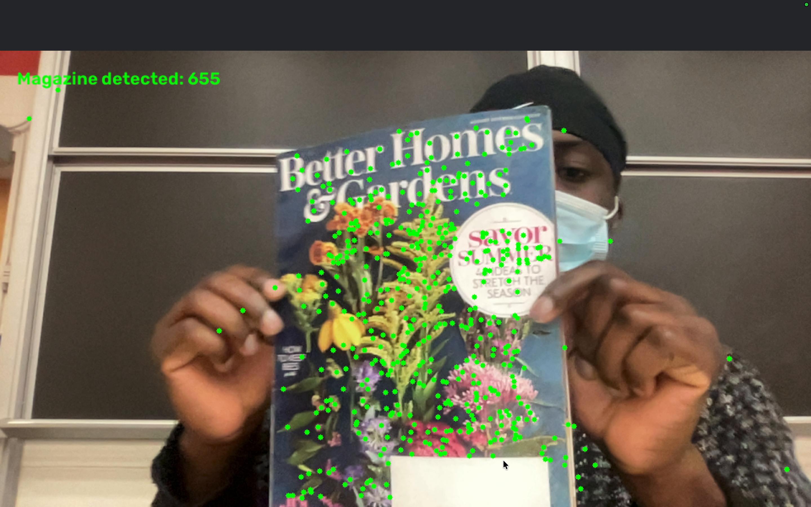
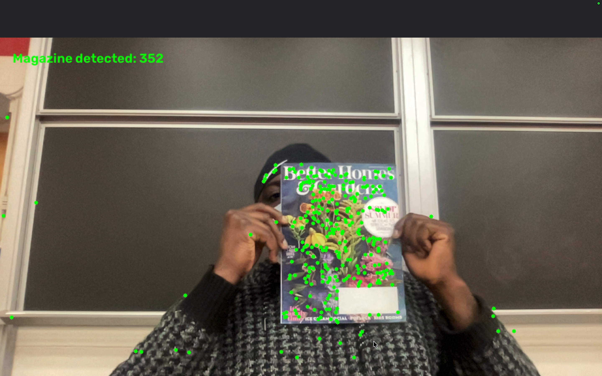
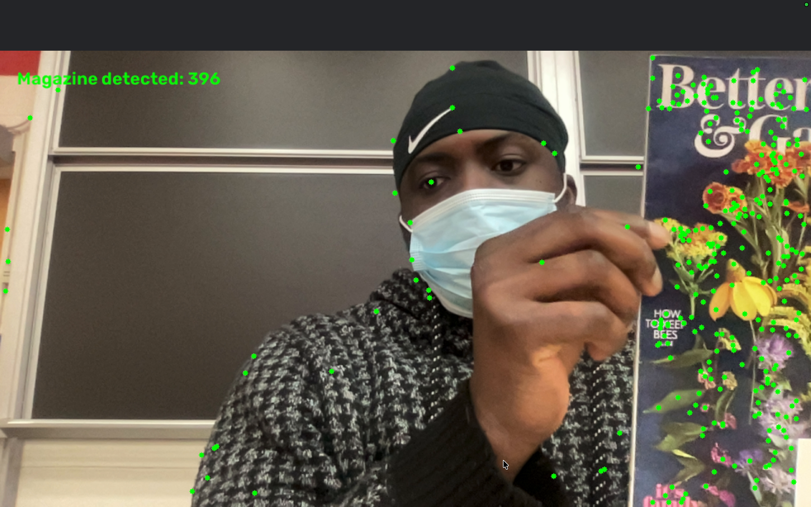
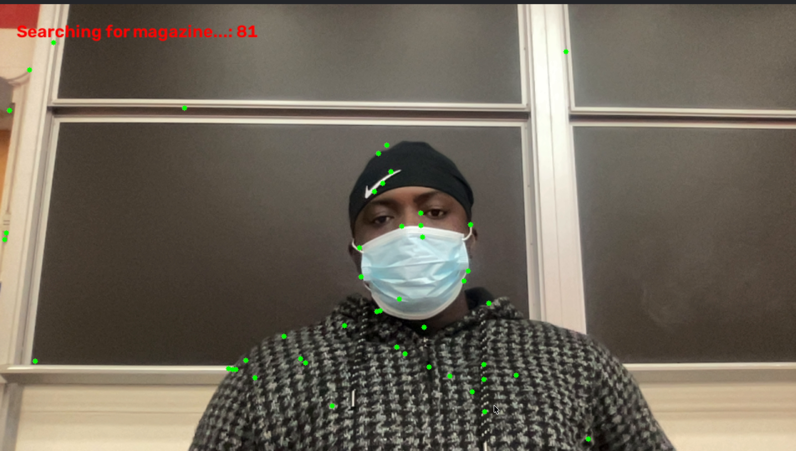

# Markerless AR 📷🖼️

**Real-Time Augmented Reality Using Feature Matching and Homography**

## PROJECT OVERVIEW

Markerless AR is a computer vision project that recognizes real-world planar objects, such as magazine covers, books, and posters, and overlays virtual images onto them in real time using a webcam.

Built using **Python and OpenCV**, the system combines SIFT feature detection, FLANN feature matching, Lowe's ratio test, RANSAC homography estimation, and perspective warping to recognize and track objects without requiring physical markers.

As the target moves or changes orientation, the application updates the transformation to keep the virtual image aligned with the detected surface.

## KEY FEATURES 🔑

- **SIFT Feature Detection:** Extracts distinctive keypoints and 128-dimensional descriptors.
- **FLANN Feature Matching:** Finds corresponding features between the reference image and webcam frames.
- **Lowe's Ratio Test:** Filters ambiguous descriptor matches using a threshold of 0.75.
- **RANSAC Homography:** Estimates a 3×3 transformation while rejecting inconsistent matches.
- **Perspective Warping:** Aligns a virtual image with the detected planar surface.
- **Real-Time Webcam Recognition:** Processes live video frames using OpenCV.
- **Detection Validation:** Uses RANSAC inlier counts and ratios to reduce false detections.
- **Recognition Status:** Displays feature matches and whether the reference target is detected.

## TECH STACK 🛠️

- **Language:** Python
- **Computer Vision:** OpenCV
- **Numerical Computing:** NumPy
- **Feature Detection:** SIFT
- **Feature Matching:** FLANN (KD-tree)
- **Outlier Rejection:** Lowe's Ratio Test and RANSAC
- **Transformation:** Homography and Perspective Warping
- **Version Control:** Git and GitHub

## PROJECT STRUCTURE 📁

```text
Markless_AR/
├── assets/
│   ├── reference.jpg
│   ├── scene.jpg
│   ├── dummy.jpg
│   ├── close_up.png
│   ├── far_away.png
│   ├── partly.png
│   └── no_obj.png
├── src/
│   ├── feature_detection.py
│   ├── feature_matching.py
│   ├── webcam_recognition.py
│   ├── homography.py
│   └── ar_overlay.py
├── main.py
├── requirements.txt
├── README.md
└── .gitignore
```

## HOW IT WORKS ⚙️

### 1. SIFT Feature Detection

The reference image and webcam frames are converted to grayscale.

OpenCV's `SIFT_create()` identifies keypoints and generates 128-dimensional descriptors representing distinctive image features.

### 2. FLANN Feature Matching

FLANN matches SIFT descriptors between the reference image and webcam frames.

Lowe's ratio test filters ambiguous matches by comparing the distances to the two nearest neighbors.

```python
if m.distance < 0.75 * n.distance:
    good_matches.append(m)
```

### 3. RANSAC Homography Estimation

Accepted feature correspondences are converted into two NumPy arrays of shape `(N, 2)`.

OpenCV's `findHomography()` uses RANSAC to estimate a transformation matrix between the reference image and webcam frame.

### 4. Perspective Warping and AR Overlay

The homography maps the reference image's corners onto the detected surface.

OpenCV's `warpPerspective()` transforms the virtual image so that it follows the position, orientation, and perspective of the target.

### 5. Live Webcam Recognition

The application continuously captures webcam frames, identifies corresponding features, evaluates their geometric consistency, and displays the augmented view when the target is detected.

## DEMO & RESULTS 📸

The following screenshots demonstrate the system's SIFT and FLANN recognition pipeline using a *Better Homes & Gardens* magazine cover.

Green markers indicate candidate feature matches detected in each frame. The displayed counts are candidate matches, not RANSAC inlier counts or detection-accuracy percentages.

### 1. Close-Range Recognition



**Result:** The system detected the magazine with **655 candidate feature matches** when the cover was close to the webcam and approximately front-facing.

### 2. Farther-Distance Recognition



**Result:** The system detected the magazine with **352 candidate feature matches** when it appeared smaller in the webcam frame.

### 3. Partial and Off-Center Recognition



**Result:** The system detected the magazine with **396 candidate feature matches** even when the cover was partially outside the camera view.

### 4. Magazine Removed — No Detection



**Result:** When the magazine was completely removed, the application displayed **"Searching for magazine"** despite finding **81 candidate feature matches**.

This demonstrates why candidate feature matches alone are insufficient for reliable target recognition.

## EXPERIMENTAL RESULTS 📊

### Static-Image Feature Matching

Two photographs of the same magazine cover were used to evaluate SIFT and FLANN matching.

| Metric | Result |
|---|---:|
| Reference Keypoints | 55,202 |
| Scene Keypoints | 41,654 |
| Candidate Match Pairs | 55,202 |
| Good Matches After Ratio Test | 11,671 |
| Match Retention Rate | 21.14% |
| Lowe's Ratio Threshold | 0.75 |

### Webcam Recognition Testing

| Test Condition | Candidate Match Range |
|---|---:|
| Directly Facing Webcam | 550–630 |
| Tilted Approximately 20° | 240–400 |
| Farther From Webcam | 170–270 |
| Partially Outside Camera View | 201–268 |
| Magazine Removed | 30–71 |

These ranges were recorded during a separate webcam testing session and are not averages of the screenshots above.

### RANSAC Evaluation

RANSAC was also used to evaluate the geometric consistency of matched features.

| Metric | Magazine Visible | Magazine Removed |
|---|---:|---:|
| Average Candidate Matches | 338.75 | 79.25 |
| Average RANSAC Inliers | 174.75 | 12.75 |
| Average Inlier Ratio | 51.78% | 16.21% |
| RANSAC Inlier Range | 145–207 | 7–21 |

These results were calculated from eight sampled readings per condition.

## INSTALLATION & SETUP 🚀

### Prerequisites

- Python 3.9+
- Webcam
- Git
- pip

### 1. Clone the Repository

```bash
git clone https://github.com/Kelony11/Markless_ARG.git
cd Markless_ARG
```

### 2. Create a Virtual Environment

```bash
python3 -m venv venv
```

Activate it on macOS/Linux:

```bash
source venv/bin/activate
```

On Windows:

```bash
venv\Scripts\activate
```

### 3. Install Dependencies

```bash
python -m pip install -r requirements.txt
```

### 4. Configure the Reference Image

The `assets/` directory contains reference images and experimental screenshots.

To recognize a different planar object, replace `assets/reference.jpg` with an image of the new target.

Ensure the webcam can clearly see the same visual content as the reference.

### 5. Run the AR Application

```bash
python main.py
```

Allow webcam access if prompted.

Point your camera toward the reference object to display the perspective-aligned virtual image.

### 6. Run Individual Components

**SIFT Feature Detection**

```bash
python src/feature_detection.py
```

**FLANN Feature Matching**

```bash
python src/feature_matching.py
```

**Live Webcam Recognition**

```bash
python src/webcam_recognition.py
```

Press `Q` while the webcam window is active to exit.

## LIMITATIONS & FUTURE IMPROVEMENTS 🔮

- Detection performance decreases under large perspective changes or significant distance.
- Lighting variations, glare, and motion blur can affect feature matching.
- Some false candidate matches occur even when the reference object is absent.
- Processing speed depends on image resolution and available hardware.

Future improvements could include optimizing feature extraction, improving geometric validation, reducing overlay jitter, and testing additional reference targets under varied environmental conditions.

## CONTRIBUTORS 👥

### Kelvin Ihezue
- SIFT feature detection and descriptor extraction
- FLANN matching and Lowe's ratio test
- Real-time webcam feature recognition
- Recognition testing and RANSAC evaluation

### Francisco Galvez
- RANSAC homography estimation
- Reference-image corner projection
- Perspective warping and AR overlay
- Homography and AR overlay validation


## LICENSE

Developed as an academic project for Machine Vision at Rutgers University. No license has been specified.
